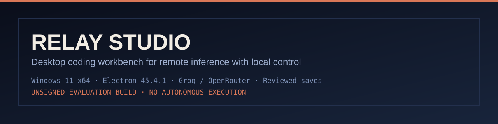
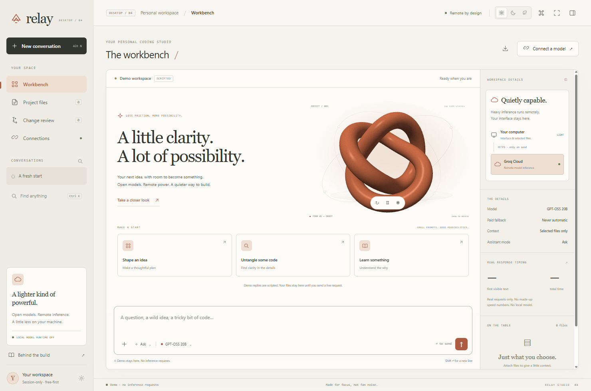
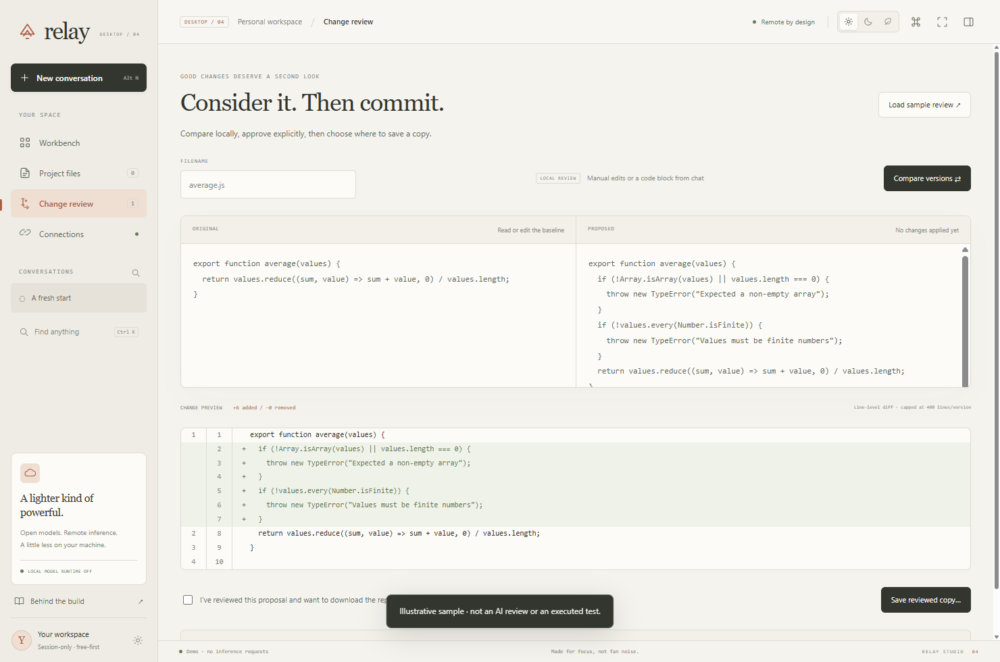
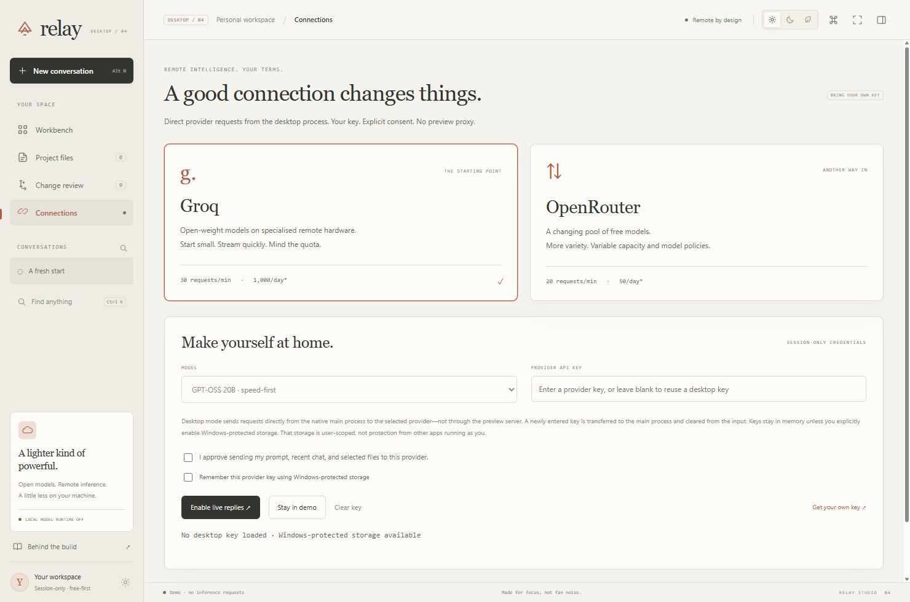
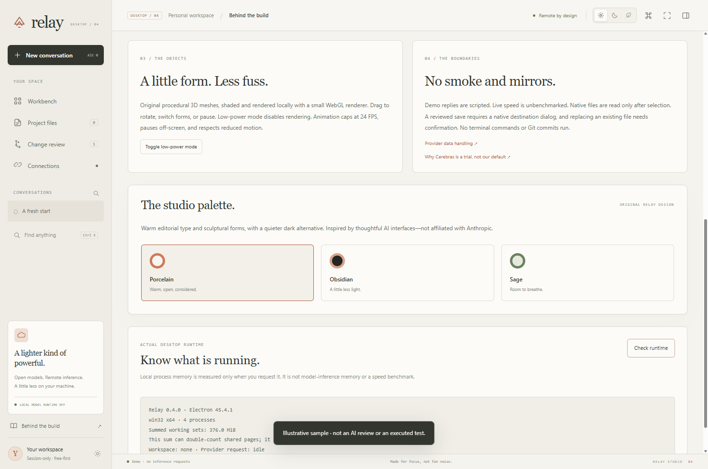
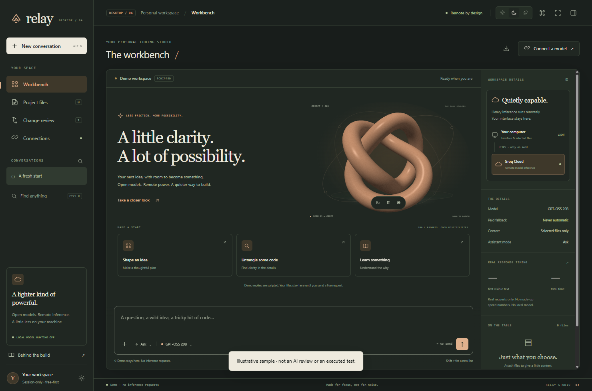

<div align="center">
  
</div>

# RELAY STUDIO :: DESKTOP CODING WORKBENCH

**A Windows 11 x64 Electron desktop workbench for remote model inference with local file control, reviewed saves, and explicit boundaries.**

<p align="center">
  
  
  
  
  
  <a href="https://github.com/Nortaq-PlayNexus/RelayStudio/actions/workflows/ci.yml"></a>
</p>

```text
┌──────────────────────────────────────────────────────────────────────────────┐
│ IDENT      Relay Studio Desktop 0.4.0                                        │
│ CLASS      Desktop coding workbench / remote inference client                │
│ STATUS     ⚠ EXPERIMENTAL — unsigned evaluation build                        │
│ STACK      Electron 45.4.1 · Node.js · Vanilla JS · WebGL · NSIS             │
│ TARGET     Windows 11 x64                                                    │
│ LINK       https://github.com/Nortaq-PlayNexus/RelayStudio                   │
└──────────────────────────────────────────────────────────────────────────────┘
```

> [!WARNING]
> Relay Studio 0.4.0 is an **unsigned evaluation build**. The original delivery package was not executed on a real Windows 11 machine in the build environment, and Windows DPAPI/smart-screen behaviour was not validated there. Review `docs/release/TEST-REPORT-DESKTOP.md` before installing. Do not bypass your organization's security policy.

## // 01 :: SIGNAL

Relay Studio is a focused desktop coding workbench that keeps the interface and file controls local while sending prompts to official remote model providers when you explicitly enable live replies. It is **not** an autonomous coding agent: it does not run shell commands, apply patches, execute tests, or upload repositories in the background.

The 0.4.0 desktop build ships as an Electron 45.4.1 Windows x64 app with a restricted preload bridge, local `relay://app/` protocol, native dialogs, read-only workspace browsing, reviewed-save flow, conversation import/export, runtime diagnostics, and opt-in Windows-protected key storage.

## // 02 :: CAPABILITIES

| Area | What it does | Boundary |
|---|---|---|
| Desktop shell | Isolated Electron window, native menus, zoom, single-instance behaviour | No Node integration in renderer; context isolation/sandbox/webSecurity enabled |
| Provider transport | Direct main-process requests to Groq/OpenRouter official endpoints | Fixed provider/model allowlists; no automatic paid fallback/switching |
| Credentials | Session-only keys by default; optional Windows safeStorage/DPAPI remember | Saved keys never returned to renderer; same-user OS risk still exists |
| Workspace | Native file/folder pickers, read-only browsing, opaque file IDs | 12 KB/file, 24 KB selected context, 4 files, bounded traversal, symlink/hidden/dependency skip |
| Review | Editable before/after diff, explicit approval, native Save dialog | No patch apply, no Git commit, no test execution, no autonomous write |
| Portability | Export/import conversation JSON archives | Exports exclude credential fields; imported text is not restored as model history |
| Diagnostics | Actual Electron process count and summed working set | Summed working set can double-count shared pages; not a benchmark |
| Browser prototype | Still-runnable local Node server + web UI | Separate boundary from desktop native transport |

## // 03 :: SCREENSHOTS

| Workspace (Porcelain) | Change review |
|---|---|
|  |  |
| *Main desktop workbench with session workspace, prompt area, and local UI controls.* | *Reviewed-save flow: compare, inspect diff, approve explicitly, then save a copy via native dialog.* |

| Connections | Behind the build / diagnostics |
|---|---|
|  |  |
| *Provider connection surface with explicit consent and opt-in key storage boundary.* | *Runtime diagnostics, export/import, and build/runtime information panel.* |

<details>
<summary>More screenshots</summary>

| Workspace (Obsidian) |
|---|
|  |
| *Dark theme variant of the main workspace.* |

</details>

> Screenshots captured on Windows 11 x64 by launching the desktop source with Electron 45.4.1 and Playwright capture. They show the app UI, not an installer endorsement.

## // 04 :: QUICK START

### Run the browser prototype (no npm install)

```powershell
git clone https://github.com/Nortaq-PlayNexus/RelayStudio.git
cd RelayStudio
$env:HOST="127.0.0.1"
node server.mjs
# Open http://127.0.0.1:3000
```

### Run the desktop shell from source

```powershell
npm install --no-save electron@45.4.1
npx electron desktop
```

### Install the Windows evaluation package

Download the `v0.4.0` release assets from [GitHub Releases](https://github.com/Nortaq-PlayNexus/RelayStudio/releases/tag/v0.4.0), verify SHA256, then run the unsigned installer:

```powershell
Get-FileHash .\RelayStudio-0.4.0-Windows-x64-Setup.exe -Algorithm SHA256
# Compare with SHA256SUMS.txt
.\RelayStudio-0.4.0-Windows-x64-Setup.exe
```

Default install: `%LOCALAPPDATA%\Programs\RelayStudio` (per-user). See [`docs/release/READ-FIRST-WINDOWS.md`](docs/release/READ-FIRST-WINDOWS.md).

## // 05 :: USAGE

### Connect a provider

1. Open **Connections**.
2. Select Groq or OpenRouter and an allowlisted model.
3. Enter your own API key.
4. Approve remote transmission.
5. Optionally enable **Remember this provider key using Windows-protected storage**.
6. Enable live replies and send a small test prompt.

Keys are memory-only unless you opt in. On Windows, remembered keys use Electron safeStorage (DPAPI-backed). The first message tests authentication; enabling live mode alone does not.

### Attach files

- `Ctrl+O` selects up to four small source files through a native dialog.
- `Ctrl+Shift+O` opens a read-only folder browser.
- Previewing is local. **Add to conversation** explicitly selects context. Only a later live send uploads selected context.

### Review and save

1. Generate or paste proposed code in Review.
2. Inspect diff.
3. Check approval.
4. **Save reviewed copy…** and choose destination in a native Save dialog.

Replacing an existing file requires confirmation. No automatic patch/apply.

## // 06 :: ARCHITECTURE

```text
RelayStudio/
├─ desktop/                 # Electron main, preload, security guards, packaging, desktop tests
├─ public/                  # Shared UI: index.html, app.js, style.css, sculpture.js, desktop-ui.js
├─ docs/
│  ├─ assets/               # banner + social preview
│  ├─ screenshots/          # README screenshots
│  ├─ release/              # READ-FIRST, TEST/BUILD reports, checksums, verify script
│  ├─ third-party/          # Electron/NSIS license texts
│  ├─ architecture.md
│  ├─ development.md
│  ├─ deployment.md
│  ├─ security.md
│  └─ api.md
├─ server.mjs               # Browser prototype local server/proxy
├─ tests.mjs                # Browser prototype tests
├─ CHANGELOG.md
├─ CONTRIBUTING.md
├─ SECURITY.md
└─ LICENSE
```

See [`docs/architecture.md`](docs/architecture.md) for the component/data-flow diagram.

## // 07 :: DATA / PROVIDERS

| Provider | Endpoint | Allowlisted models | Key source |
|---|---|---|---|
| Groq | `https://api.groq.com/openai/v1/chat/completions` | `openai/gpt-oss-20b`, `openai/gpt-oss-120b` | User key (session or Windows-protected storage) |
| OpenRouter | `https://openrouter.ai/api/v1/chat/completions` | `openrouter/free` | User key (session or Windows-protected storage) |

Notes:
- Requests go directly from the desktop main process to the provider.
- The browser prototype uses `server.mjs` as a local proxy boundary; do not expose it publicly with a valuable env key.
- Free accounts are limited by provider quotas/rate limits/terms. Relay Studio does no paid fallback or quota evasion.
- No real provider inference benchmark was performed in the original delivery.

## // 08 :: HONEST LIMITATIONS

- **Unsigned evaluation build.** SmartScreen / organizational policy may block it. Code signing is a release gate.
- **Windows install/DPAPI not validated in the original delivery environment.** The Linux Electron shell was tested with mocked dialogs and mocked SSE; see [`docs/release/TEST-REPORT-DESKTOP.md`](docs/release/TEST-REPORT-DESKTOP.md).
- **No autonomous coding agent.** No shell bridge, no test runner, no Git commit, no background patch apply, no repository crawl/upload.
- **Not a security audit.** The narrow bridge reduces risk but is not a penetration test or formal audit.
- **No automatic updater.** Electron/Chromium must be updated and re-tested for future releases.
- **DPAPI is not magic.** Windows-protected storage is scoped to the Windows user; it does not protect against every same-user process/malware.
- **Bundled runtime is large.** The installer size reflects Electron runtime, not compute quality.
- **Provider reality applies.** Latency, availability, quotas, privacy, and model behavior are controlled by the provider and account.

## // 09 :: SECURITY / LEGAL

- Use only with accounts and keys you are authorized to use.
- Do not paste secrets into prompts or exports you plan to share.
- Treat generated code as untrusted until reviewed.
- See [`SECURITY.md`](SECURITY.md) for reporting and scope.
- Third-party licenses: [`docs/third-party/ELECTRON-LICENSE.txt`](docs/third-party/ELECTRON-LICENSE.txt), [`docs/third-party/NSIS-LICENSE.txt`](docs/third-party/NSIS-LICENSE.txt).

## // 10 :: DOCS / RELEASE

- [Architecture](docs/architecture.md)
- [Development](docs/development.md)
- [Deployment / release checklist](docs/deployment.md)
- [Security](docs/security.md)
- [API / interfaces](docs/api.md)
- [Changelog](CHANGELOG.md)
- [Windows read-first](docs/release/READ-FIRST-WINDOWS.md)
- [Desktop test report](docs/release/TEST-REPORT-DESKTOP.md)
- [Build report](docs/release/BUILD-REPORT.json)

## // 11 :: LICENSE

[MIT](LICENSE) © 2026 DJ PhantomTape / Nortaq-PlayNexus.

Electron and NSIS retain their respective upstream licenses in distributed/runtime artifacts.
