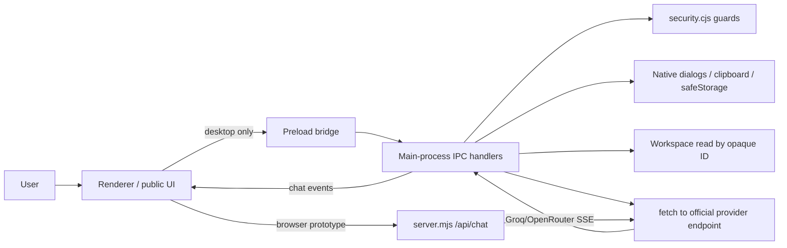

# Architecture

## Components

| Component | Path | Role |
|---|---|---|
| Browser prototype server | `server.mjs` | Local Node HTTP server serving `public/` and proxying `/api/chat` with fixed provider/model allowlists. |
| Web UI | `public/index.html`, `public/app.js`, `public/style.css` | Workspace, files, review, connections, blueprint views; theme switching; command palette. |
| 3D sculpture | `public/sculpture.js` | Small dependency-free WebGL renderer (Orbit/Bloom/Knot), capped FPS, reduced-motion aware. |
| Desktop UI adapter | `public/desktop-ui.js` | Activates only when `window.relayDesktop` exists; swaps browser fetch/file/clipboard flows for native bridge calls. |
| Desktop main process | `desktop/main.cjs` | Electron app: `relay://app/` protocol, CSP, window/menu, IPC handlers, dialogs, workspace IDs, provider transport, safeStorage. |
| Preload bridge | `desktop/preload.cjs` | Narrow `contextBridge` API; no general fs/shell/IPC/eval. |
| Security guards | `desktop/security.cjs` | Pure validation: provider/model allowlists, chat shape/size, file extension/size/name checks, workspace boundary, archive validation. |
| Packaging | `desktop/installer.nsi`, `desktop/package-release.py`, `desktop/build.py` | NSIS installer build and release packaging helpers. |

## Data flow

## Boundaries

- **Renderer**: no Node integration, context isolation on, sandbox on, webSecurity on.
- **IPC**: caller must be main window main frame at `relay://app/index.html`.
- **Files**: user-selected dialogs only; workspace reads use opaque IDs and realpath boundary checks; 12 KB/file, 24 KB total selected context.
- **Provider**: fixed official endpoints and model allowlists; key stays in main process; saved keys never returned to renderer.
- **Writes**: reviewed copy/archive save requires native Save dialog; replace requires confirmation. No autonomous patch/write.
- **External links**: `https://` + official host allowlist + confirmation dialog.
